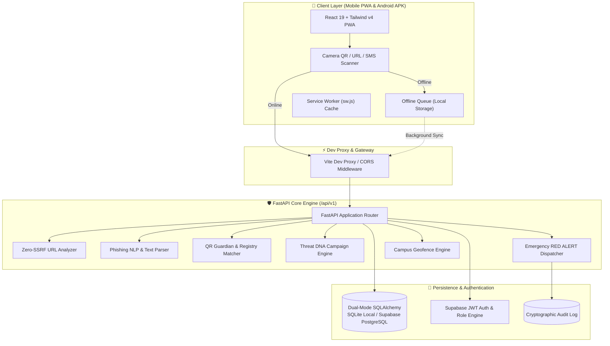

# 🛡️ YODHRA — Campus Cyber Intelligence & Emergency Defense Platform

<div align="center">


**Unified Campus Cybersecurity, Threat DNA Clustering & Emergency Red Alert Mesh**

[](https://fastapi.tiangolo.com)
[](https://www.python.org/)
[](https://react.dev/)
[](https://www.typescriptlang.org/)
[](https://tailwindcss.com/)
[](https://vite.dev/)
[](https://web.dev/progressive-web-apps/)
[](https://capacitorjs.com/)

</div>

---

## 📌 Executive Summary

**YODHRA** (*formerly SignalSafe Campus*) is a next-generation campus cybersecurity ecosystem engineered specifically for universities and higher-education institutions. 

In modern campus environments, students and faculty are continually targeted by sophisticated phishing campaigns, fraudulent QR stickers on physical notice boards (*quishing*), impersonated bursar/financial-aid portals, and spoofed administrative alerts. 

YODHRA provides an **explainable, multi-vector threat detection and real-time incident mitigation platform**, featuring:
- **Zero-SSRF Client & Backend Inspection**: Analyzes targets syntactically and heuristically without issuing dangerous blind outbound server requests.
- **Explainable Threat Risk Scoring (0–100)**: Plain-language security indicator breakdowns and actionable defense recommendations.
- **QR Guardian & Tamper Detection**: Camera-based scanner with cryptographic signature verification against an institutional registry.
- **Threat DNA Campaign Clustering**: Automatically aggregates scattered student incident reports into unified attack campaigns.
- **Emergency RED ALERT Mesh**: Instant campus-wide broadcast relay with SHA-256 tamper-proof user acknowledgment logging.
- **Offline-First Resilience**: Mobile-first PWA with local encrypted queue and automatic background synchronization.

---

## 🏗️ System Architecture



---

## ✨ Key Innovation Modules

| Feature Module | Route | Description |
|---|---|---|
| **🔍 Explainable Threat Scanner** | `/scan` | Heuristically inspects suspicious URLs and phishing messages for IP literals, punycode, typosquatting, brand impersonation, and urgency traps. |
| **📷 QR Guardian & Quishing Shield** | `/qr-scanner` | On-demand camera QR decoder that prevents automated browser redirection and compares target URLs with the institutional verified registry. |
| **🧬 Threat DNA & Attack Clustering** | `/threat-dna` | Analyzes incident IOCs, matches threat patterns across departments, and correlates distributed attacks into active campaigns. |
| **🚨 Emergency RED ALERT Mesh** | `/radar` | Broadcasts real-time critical campus alerts with proximity targeting and SHA-256 verified user receipt acknowledgments. |
| **🌐 Trust Graph & Verified Directory** | `/trust-graph` | An authentic index of verified campus departmental portals, payment systems, and administrative contacts. |
| **🛰️ Campus Cyber Radar** | `/radar` | Live campus map visualizer showing departmental exposure ratings, localized threat heatmaps, and coordinate geofencing. |
| **🎓 Cyber Coach & Interactive Training** | `/coach` | Gamified security training modules and interactive phishing quizzes that evaluate campus cyber readiness. |
| **📂 Forensic Dossier Exporter** | `/reports/:id` | Generates cryptographically signed, immutable incident timelines with SHA-256 evidence integrity hashes. |

---

## 🛠️ Technology Stack

### Frontend Application (`mobile-pwa/`)
- **Framework:** React `19.3.1` (Strict Mode)
- **Language:** TypeScript `~7.0.2`
- **Build System:** Vite `8.3.5` + `@vitejs/plugin-react`
- **Styling:** Tailwind CSS `v4.3.3` + `@tailwindcss/vite`
- **Routing:** React Router DOM `v7.18.5`
- **Hardware Integrations:** `html5-qrcode` (camera QR capture)
- **Mobile Container:** `@capacitor/core` & `@capacitor/android` `8.6.0`
- **Icons:** Lucide React `v1.65.0`
- **Authentication:** Supabase Client SDK `@supabase/supabase-js` `2.118.0`

### Backend Platform (`backend/`)
- **Runtime:** Python `3.12+` / `3.14+`
- **Web Framework:** FastAPI `0.110+` / `0.143.0`
- **ASGI Server:** Uvicorn `0.54.0` (with WatchFiles reloader)
- **Data Validation:** Pydantic `v2.14.1`
- **ORM & DB Access:** SQLAlchemy `2.0+` with SQLite & PostgreSQL (`psycopg3`)
- **Security & Tokens:** PyJWT `2.15.1`, passlib, argon2-cffi
- **Testing:** Pytest `8.4.2` with pytest-asyncio

---

## 🚀 Quick Start (Local Development)

### Prerequisites
- **Node.js**: v18.0.0 or newer (v20+ recommended)
- **Python**: v3.11 or newer
- **Git**

### 1. Clone the Repository
```bash
git clone https://github.com/omkar2xt/Hackfusion2.0-APP.git
cd Hackfusion2.0-APP
```

### 2. Unified One-Command Run (Recommended)
You can start both the **FastAPI Backend** and the **Vite React Frontend** with a single command:

```bash
python dev.py
```
*(On Windows, you can also simply double-click `start_dev.bat`)*

**Output:**
```text
============================================================
Launching SignalSafe Campus - Backend & Frontend
============================================================
[1/2] Starting FastAPI Backend on http://127.0.0.1:8000 ...
[2/2] Starting Vite Frontend on http://localhost:5173 ...

============================================================
Both servers are up and running!
  * Frontend UI:     http://localhost:5173
  * Backend API:     http://127.0.0.1:8000
  * Swagger Docs:    http://127.0.0.1:8000/docs
  * Health Check:    http://127.0.0.1:8000/api/v1/health
============================================================
```

---

### 3. Manual Step-by-Step Startup

#### Step A: Backend
```bash
cd backend
python -m pip install -r requirements.txt
cp .env.example .env
python -m uvicorn app.main:app --host 127.0.0.1 --port 8000 --reload
```
Interactive Swagger documentation will be available at **`http://localhost:8000/docs`**.

#### Step B: Frontend
```bash
cd mobile-pwa
npm install
npm run dev
```
Open **`http://localhost:5173`** in your browser.

---

## 🛡️ Core REST API Reference (`/api/v1`)

| Method | Endpoint | Description |
|---|---|---|
| `GET` | `/api/v1/health` | Service health status and database liveness verification |
| `POST` | `/api/v1/scan/url` | Zero-SSRF heuristic URL inspection and risk calculation |
| `POST` | `/api/v1/scan/message` | Phishing SMS and email NLP analysis |
| `POST` | `/api/v1/scan/qr` | Safe QR payload inspection and redirection check |
| `POST` | `/api/v1/qr-guardian/analyze` | Quishing scan against official verified destination registry |
| `GET` | `/api/v1/dashboard/stats` | Aggregated campus security metrics and recent scans feed |
| `POST` | `/api/v1/incidents` | Submit forensic incident report (supports offline sync) |
| `GET` | `/api/v1/incidents` | Filter and list student and campus security incidents |
| `GET` | `/api/v1/incidents/{id}/timeline`| Immutable chronological investigation milestone history |
| `GET` | `/api/v1/incidents/{id}/export` | Export SHA-256 tamper-proof incident evidence dossier |
| `POST` | `/api/v1/threat-dna/analyze` | Threat fingerprinting and automatic campaign clustering |
| `GET` | `/api/v1/threat-dna/campaigns` | Retrieve active correlated phishing/malware campaigns |
| `GET` | `/api/v1/cyber-radar/overview` | Aggregated departmental vulnerability map & exposure scores |
| `POST` | `/api/v1/alerts/broadcast` | Issue authenticated campus emergency RED ALERT |
| `POST` | `/api/v1/alerts/{id}/acknowledge`| Cryptographically acknowledge emergency alert reception |
| `GET` | `/api/v1/trust-graph/identities` | Query institutional verified department and portal directory |

---

## 📱 Mobile PWA & Android Native Build

The frontend is fully configured as both a **Progressive Web App (PWA)** and a **Native Android Application** powered by Capacitor:

### Run / Build Android APK
```bash
cd mobile-pwa

# 1. Build optimized production web assets
npm run build

# 2. Sync web bundle to Android native container
npx cap sync android

# 3. Open in Android Studio or compile APK
npx cap open android
```

---

## 🧪 Testing & Quality Assurance

### Run Backend Tests (Pytest)
```bash
cd backend
python -m pytest tests -v
```

### Run Frontend Linter & Build Validation
```bash
cd mobile-pwa
npm run lint
npm run build
```

---

## 📂 Project Structure

```text
HackFusion-2.0-APP/
├── dev.py                       # Unified local development runner
├── start_dev.bat                # Windows double-click launcher
├── requirements.txt             # Root Python requirements link
├── README.md                    # Primary repository documentation
├── YODHRA_TECHNICAL_ARCHITECTURE.md # Enterprise architectural specification
│
├── backend/                     # FastAPI Core Service
│   ├── app/
│   │   ├── api/routes/          # 13 REST API controllers
│   │   ├── core/                # Config, security, JWT handling
│   │   ├── database/            # SQLAlchemy models, sessions, migrations
│   │   ├── schemas/             # Pydantic schemas & response models
│   │   └── services/            # URL analyzer, NLP, Threat DNA, Radar
│   ├── tests/                   # Pytest automated test suite
│   ├── signalsafe.db            # Local SQLite database
│   ├── requirements.txt         # Backend Python dependencies
│   └── README.md                # Dedicated backend documentation
│
└── mobile-pwa/                  # React 19 PWA & Android App
    ├── public/                  # PWA Webmanifest, Service Worker, Brand logos
    ├── src/
    │   ├── components/          # Reusable UI components & Red Alert banners
    │   ├── contexts/            # Supabase AuthContext & state providers
    │   ├── hooks/               # Custom data hooks (useScan, useIncidents)
    │   ├── pages/               # Application view components (Dashboard, Scan, Radar)
    │   ├── services/            # Unified API Client with dev proxy routing
    │   └── types/               # TypeScript interfaces & API contracts
    ├── capacitor.config.ts      # Native Android container configuration
    ├── vite.config.ts           # Vite bundler & reverse proxy rules
    └── package.json             # Frontend dependencies & scripts
```

---

## 🔒 Security Best Practices

1. **Zero SSRF (Server-Side Request Forgery)**: The threat analysis engines parse and analyze URLs purely through syntax heuristics, IP ranges, character encodings, and pattern extraction—never fetching the remote URL from the backend server.
2. **CORS Hardening**: Production endpoints restrict origins to verified client domains while seamlessly permitting local development on `localhost` and `capacitor://localhost`.
3. **Audit Trails**: Emergency broadcasts and security mitigations log immutable SHA-256 audit hashes to ensure non-repudiation.
4. **Offline Data Isolation**: Cached offline incident payloads are isolated within the device's sandboxed storage and cleared upon confirmed server synchronization.

---

## 📄 License

This project is developed for hackathons and academic campus cybersecurity defense. Licensed under the [MIT License](LICENSE).
