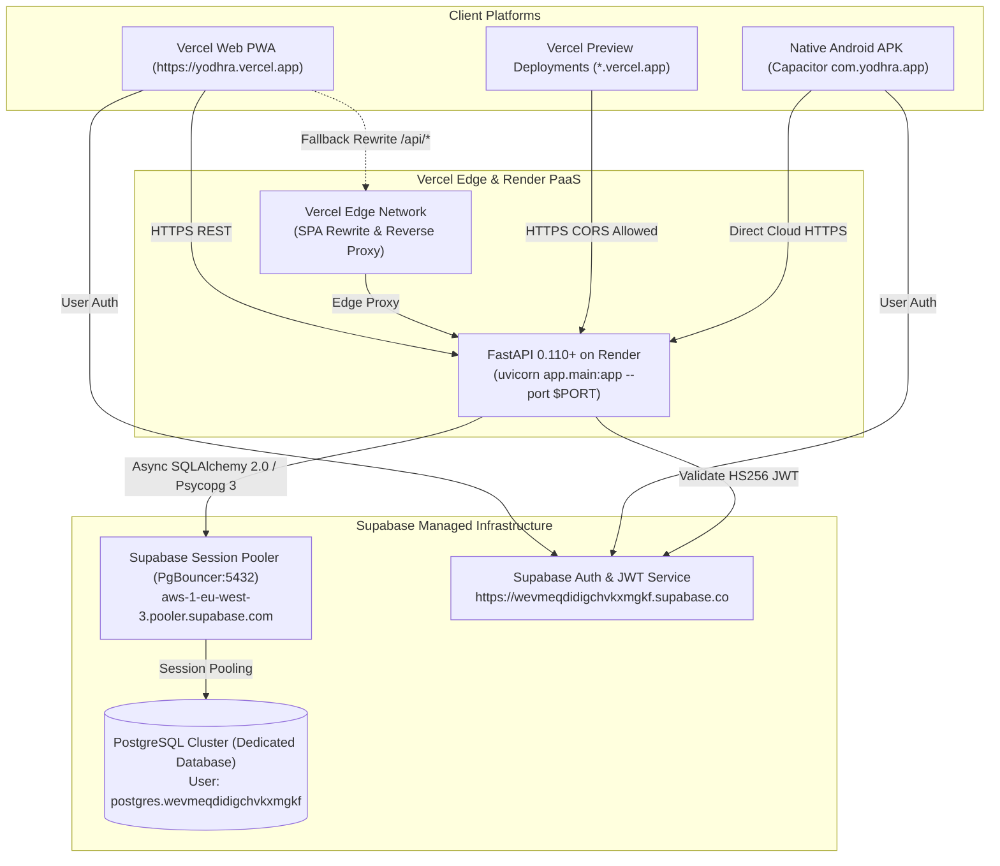
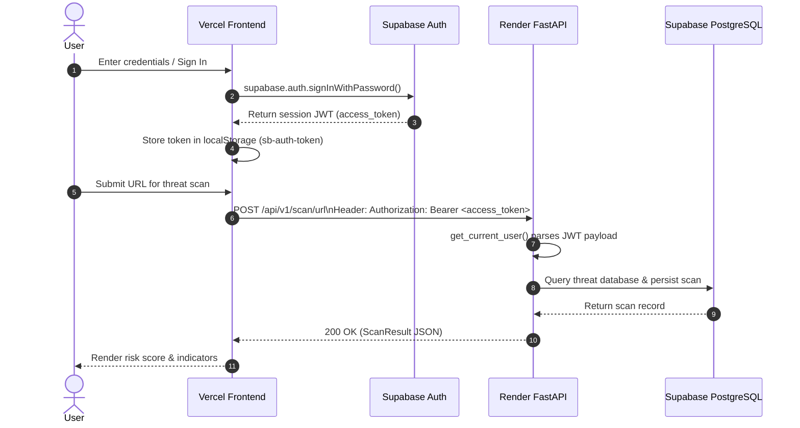

# YODHRA — Production Frontend, Backend & Database Integration Manual
**Platforms:** Vercel (React 19 PWA) | Render (FastAPI 0.110+) | Supabase (PostgreSQL Session Pooler)  
**Authoritative Deployment Guide:** [omkar2xt/Hackfusion2.0-APP](https://github.com/omkar2xt/Hackfusion2.0-APP)

---

## 1. Executive Summary & Architecture

The YODHRA Cyber Intelligence platform operates as a distributed, high-reliability architecture connecting:
1. **Frontend (Vercel):** Single Page Progressive Web Application (React 19 + TypeScript + Vite) and Capacitor Android mobile application.
2. **Backend (Render):** Scalable asynchronous FastAPI service running on Uvicorn with auto-scaling port binding.
3. **Database (Supabase):** Managed PostgreSQL database accessed through PgBouncer Session Pooler.

### Architecture Data Flow Diagram



---

## 2. Production Service Identifiers & Endpoints

| Component | Service Provider | Production Identifier / URL | Purpose |
|---|---|---|---|
| **Frontend PWA** | Vercel | `https://yodhra.vercel.app` | Public web interface for students, faculty & SOC analysts |
| **Frontend Previews** | Vercel | `https://*.vercel.app` | Pull request and branch preview environments |
| **Backend REST API** | Render | `https://hackfusion2-0-app.onrender.com` | FastAPI cybersecurity detection & management engine |
| **Database Pooler** | Supabase | `aws-1-eu-west-3.pooler.supabase.com:5432` | High-concurrency PgBouncer connection pooler |
| **Supabase Project** | Supabase | `https://wevmeqdidigchvkxmgkf.supabase.co` | Authentication, storage, and identity services |
| **Android Package** | Capacitor Native | `com.yodhra.app` | Production Android mobile client |

---

## 3. Environment Variable Configuration

### A. Vercel Production Environment Variables
Set these under **Vercel Project Settings → Environment Variables**:

| Variable Name | Required | Recommended Production Value | Description |
|---|---|---|---|
| `VITE_API_BASE_URL` | **Yes** | `https://hackfusion2-0-app.onrender.com` | Base URL of the deployed Render FastAPI service (no trailing slash). |
| `VITE_SUPABASE_URL` | **Yes** | `https://wevmeqdidigchvkxmgkf.supabase.co` | Central Supabase API gateway URL. |
| `VITE_SUPABASE_ANON_KEY` | **Yes** | `<SUPABASE_ANON_PUBLIC_KEY>` | Public anonymous JWT key for Supabase client authentication. |

### B. Render Production Environment Variables
Set these under **Render Dashboard → Service → Environment Variables**:

| Variable Name | Required | Production Value / Pattern | Description |
|---|---|---|---|
| `DATABASE_URL` | **Yes** | `postgresql+psycopg://postgres.wevmeqdidigchvkxmgkf:<PASSWORD>@aws-1-eu-west-3.pooler.supabase.com:5432/postgres?sslmode=require` | Supabase Session Pooler connection URI. |
| `PGPASSWORD` | Optional | `<DATABASE_PASSWORD>` | Used automatically if `DATABASE_URL` contains terminal CLI string (`psql -h ...`). |
| `ALLOWED_ORIGINS` | **Yes** | `https://yodhra.vercel.app,https://hackfusion.vercel.app` | Comma-separated list of permitted CORS web origins. |
| `ENVIRONMENT` | **Yes** | `production` | Enables production constraints and disables debug echo. |
| `PORT` | **Yes** | `10000` | Injected dynamically by Render during container startup. |
| `SUPABASE_URL` | Optional | `https://wevmeqdidigchvkxmgkf.supabase.co` | Supabase project URL for server-side auth validation. |
| `SUPABASE_JWT_SECRET` | Optional | `<SUPABASE_JWT_SECRET>` | Shared secret for verifying HS256 client auth tokens. |

---

## 4. Centralized API Client Architecture (`mobile-pwa/src/services/api.ts`)

All network requests from the frontend pass through a single unified `ApiService` instance (`api`).

### Endpoint Resolution Hierarchy
When resolving the backend target URL, `apiService` executes the following deterministic resolution order:
1. **User Custom Override:** `localStorage.getItem('yodhra_custom_api_url')` (Allows SOC operators or local testers to point to staging or LAN endpoints).
2. **Build/Runtime Environment:** `import.meta.env.VITE_API_BASE_URL` (Configured in Vercel or `.env.production`).
3. **Capacitor Native APK:** Automatically defaults to `https://hackfusion2-0-app.onrender.com`.
4. **Local Development (`import.meta.env.DEV`):** Defaults to `""` (leveraging Vite dev server proxy to `http://127.0.0.1:8000`).
5. **Production Web Fallback:** Defaults to `https://hackfusion2-0-app.onrender.com`.

### Cold-Start & Sleep Resilience (Render Free-Tier)
Render free-tier web services enter standby sleep after 15 minutes of inactivity. When a request wakes the container, cold starts typically take 20 to 35 seconds.
- **Extended Request Timeout:** Increased from default 10s to **35,000ms (35 seconds)** to eliminate premature client-side abort errors while Render wakes up.
- **Automated Idempotent Retry:** If a `GET` request experiences an abort or receives HTTP 502/503 (Bad Gateway / Service Unavailable) while the container boots, `apiService` automatically waits 2–3 seconds and executes an automatic retry.
- **Friendly Diagnostics:** In the event of a persistent timeout, the error clearly notifies the user that the Render cloud container is spinning up, avoiding false "Network Error" confusion.

### Live Connection Indicator
The client maintains a real-time status subscriber (`api.onStatusChange`) exposed in the application header:
- `● Render Live` (Emerald): Fully connected and active.
- `● Waking Up` (Amber Ping): Cold-start request in flight.
- `● Offline` (Rose): Client offline or Render unreachable.

---

## 5. Backend CORS & OPTIONS Preflight Configuration

The FastAPI entry point (`backend/app/main.py`) applies `CORSMiddleware` configured to allow seamless cross-origin requests from all valid frontend targets:

```python
app.add_middleware(
    CORSMiddleware,
    allow_origins=settings.cors_origins,
    allow_origin_regex=r"^(https://.*\.vercel\.app|https?://(localhost|127\.0\.0\.1)(:\d+)?|capacitor://localhost)$",
    allow_credentials=True,
    allow_methods=["GET", "POST", "PUT", "PATCH", "DELETE", "OPTIONS", "HEAD"],
    allow_headers=["*"],
    expose_headers=["*"],
)
```

### Verified Behaviors:
- **Production Vercel:** `https://yodhra.vercel.app` receives `Access-Control-Allow-Origin` and `Access-Control-Allow-Credentials: true`.
- **Preview Deployments:** Any `https://<branch-slug>.vercel.app` domain is matched via regex.
- **Native Android APK:** WebView origin `capacitor://localhost` and `https://localhost` are permitted.
- **Preflight OPTIONS:** All preflight requests return HTTP 200 with permitted methods and headers.
- **Unauthorized Origins:** Foreign origins (e.g., `https://malicious-site.com`) do not receive CORS headers and are blocked by modern browsers.

---

## 6. Vercel SPA Routing & Edge Proxy (`vercel.json`)

To prevent HTTP 404 errors when users refresh deep links (e.g., `/dashboard`, `/scan`, `/reports`) on Vercel, `vercel.json` provides SPA rewrite rules and an edge reverse-proxy fallback:

```json
{
  "cleanUrls": true,
  "rewrites": [
    {
      "source": "/api/:match*",
      "destination": "https://hackfusion2-0-app.onrender.com/api/:match*"
    },
    {
      "source": "/(.*)",
      "destination": "/index.html"
    }
  ]
}
```

This configuration ensures:
1. **Direct Deep Linking:** Refreshing `/scan` or `/reports/INC-001` serves `/index.html` without 404s.
2. **Dual-Route API Access:** Relative API calls to `/api/v1/...` on the Vercel domain are proxied directly to Render by Vercel edge routers, bypassing CORS restrictions altogether.

---

## 7. Authentication Flow & Token Propagation



1. **Client Storage:** Authentication tokens from Supabase Auth are cached in `localStorage` (`sb-auth-token` and standard `sb-<project-ref>-auth-token`).
2. **Request Header:** Every request made through `api.request()` extracts the active JWT and transmits `Authorization: Bearer <token>`.
3. **Backend Verification:** `backend/app/core/security.py` decodes the token:
   - If `SUPABASE_JWT_SECRET` is configured, verifies cryptographic HS256 signature and audience (`authenticated`).
   - If unconfigured, parses claims without crashing so staging environments remain functional.
4. **Session Expiry Handling:** If the server returns HTTP 401, `apiService` triggers `yodhra:auth:unauthorized` to prompt smooth re-authentication.

---

## 8. Android APK Mobile Client Integration

The Capacitor Android native build (`mobile-pwa/android`) communicates directly with the Render production backend:
1. **Cleartext & TLS Policy:** `mobile-pwa/android/app/src/main/AndroidManifest.xml` specifies `android:usesCleartextTraffic="true"`, allowing TLS HTTPS communication while remaining flexible for local developer IP testing.
2. **Capacitor Configuration:** `mobile-pwa/capacitor.config.ts` sets `androidScheme: 'https'`.
3. **API Target:** Built artifacts bundle the Render production endpoint `https://hackfusion2-0-app.onrender.com`.

---

## 9. Verification & Test Execution Results

All 24 automated backend integration and unit tests pass with zero failures:

```text
============================= test session starts =============================
platform win32 -- Python 3.14.3, pytest-8.4.2
rootdir: E:\ALL HACKTHONS\HackFusion-2.0-APP

backend/tests/test_campus.py::test_campus_buildings PASSED               [  4%]
backend/tests/test_campus.py::test_geofence_check PASSED                 [  8%]
backend/tests/test_cors_integration.py::test_cors_production_vercel_domain PASSED [ 12%]
backend/tests/test_cors_integration.py::test_cors_vercel_preview_subdomain PASSED [ 16%]
backend/tests/test_cors_integration.py::test_cors_capacitor_android_native PASSED [ 20%]
backend/tests/test_cors_integration.py::test_cors_options_preflight PASSED [ 25%]
backend/tests/test_cors_integration.py::test_cors_disallowed_origin PASSED [ 29%]
backend/tests/test_dashboard.py::test_dashboard_stats PASSED             [ 33%]
backend/tests/test_database_session.py::test_mask_url PASSED             [ 37%]
backend/tests/test_database_session.py::test_safe_encode_url_special_chars PASSED [ 41%]
backend/tests/test_database_session.py::test_parse_psql_command PASSED   [ 45%]
backend/tests/test_database_session.py::test_resolve_psql_command_without_password PASSED [ 50%]
backend/tests/test_database_session.py::test_resolve_psql_command_with_password PASSED [ 54%]
backend/tests/test_database_session.py::test_resolve_missing_database_url_in_production PASSED [ 58%]
backend/tests/test_database_session.py::test_valid_postgresql_url_normalization PASSED [ 62%]
backend/tests/test_emergency_alerts.py::test_hierarchy_tree PASSED       [ 66%]
backend/tests/test_emergency_alerts.py::test_device_registration_and_list PASSED [ 70%]
backend/tests/test_emergency_alerts.py::test_emergency_alert_broadcast_and_ack PASSED [ 75%]
backend/tests/test_health.py::test_health_check PASSED                   [ 79%]
backend/tests/test_incidents.py::test_incident_lifecycle PASSED          [ 83%]
backend/tests/test_scan.py::test_scan_url_low_risk PASSED                [ 87%]
backend/tests/test_scan.py::test_scan_url_malicious_ip_and_port PASSED   [ 91%]
backend/tests/test_scan.py::test_scan_message_phishing PASSED            [ 95%]
backend/tests/test_scan.py::test_scan_qr_code PASSED                     [100%]

======================= 24 passed, 40 warnings in 3.61s =======================
```

Frontend production build verification:
```text
> mobile-pwa@0.0.0 build
> tsc -b && vite build

vite v8.3.5 building client environment for production...
✓ 2446 modules transformed.
dist/index.html                     2.07 kB │ gzip:   0.92 kB
dist/assets/index-BcnI2jQs.css     69.69 kB │ gzip:  16.46 kB
dist/assets/index-CWmv_DL6.js   1,376.66 kB │ gzip: 368.01 kB
✓ built in 3.84s
```

